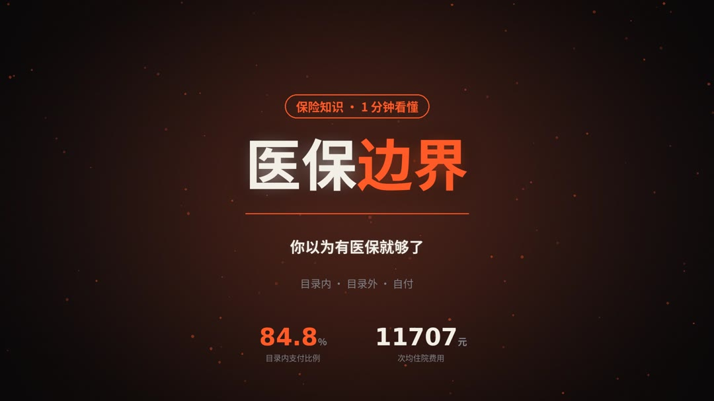
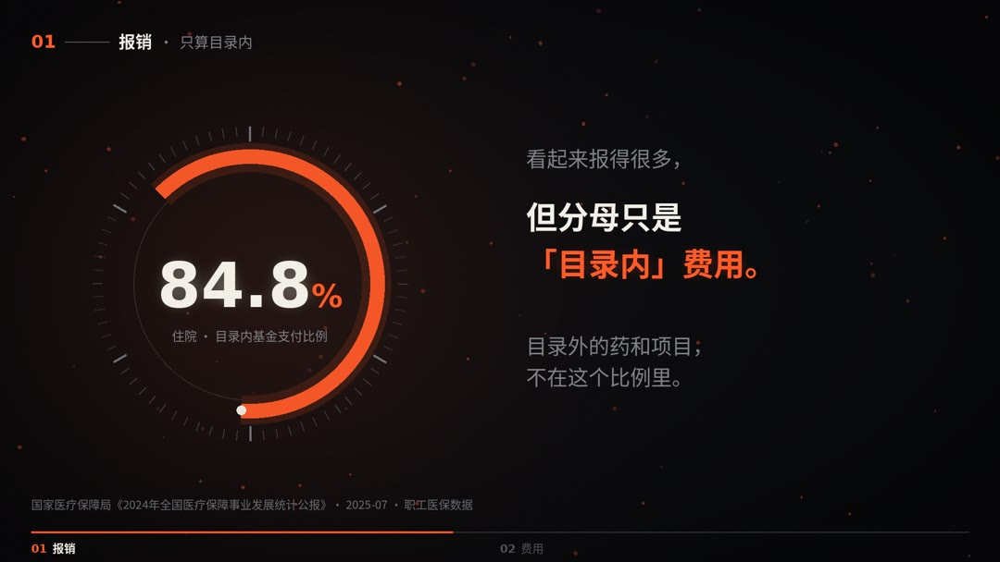
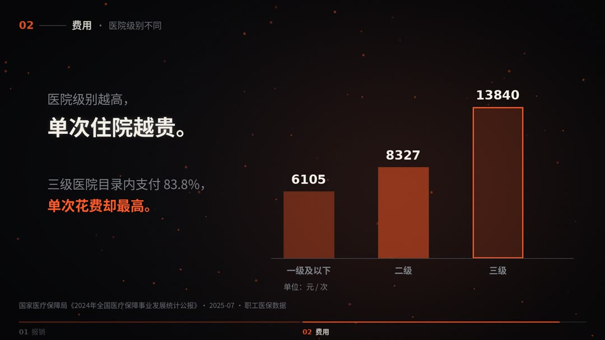

# 暗黑数据可视化科普短视频 Skill（dark-infographic-video）

> 🔴 **作者：袁六伟 · 台州汇芯**｜一人 AI 公司创业者，6000+ 学员，100+ 客户，得到/华为分享老师
> 📮 更多 AI 视频与自动化实战，关注 **公众号 / 视频号：袁六伟**

## 效果展示

> 样片：医保边界，数据来源：国家医保局 2024 年统计公报，由本 Skill 渲染。


| | |
|:---:|:---:|
|  |  |
| 横屏首帧，中心即一张 3:4 竖版封面 | 钩子：次均住院费用滚动到 ¥11707 |
|  |  |
| 认知反差：「你以为…其实…」 | 圆环仪表：目录内基金支付比例 84.8% |
|  |  |
| 柱状图：医院级别越高，单次住院越贵 | 圆环从 0 滚到 84.8% 的动画 |
|  | |
| 结尾：3 条建议 + 一句升华 | |


用 AI agent 一键产出「深黑背景 + 橙红光晕 + 动态数字/图表」风格的数据可视化科普短视频。自带可直接运行的 Python 渲染引擎，只依赖 ffmpeg + Pillow + numpy，内置跨平台中文字体探测。

*An Agent Skill for dark-style data-infographic explainer videos (ffmpeg + Pillow + numpy).*

## 安装

```bash
npx skills add sixwei2025/dark-infographic-video-skill
```

也可以把 `skills/dark-infographic-video/` 整个文件夹拷进你的 agent 的 skills 目录，Claude Code、Codex、WorkBuddy 等支持 SKILL.md 的 agent 都能用。

## 依赖

- Python 3.9+，并安装 `pip install pillow numpy`
- ffmpeg
- 中文字体：`engine.py` 会自动探测（macOS PingFang/Hiragino，Linux Noto Sans CJK/思源黑体/文泉驿，Windows 微软雅黑）。Linux 上没有中文字体时先装一个，例如 `sudo apt install fonts-noto-cjk`；也可以用 `export DARK_FONT=/path/to/font.ttc` 直接指定。

## 快速开始

1. 对 agent 说：「用 dark-infographic-video 做一个『熬夜的危害』数据可视化短视频」。
2. agent 会按 `SKILL.md` 的流程走：先检索真实数据、整理来源，再写场景，最后调用 `scripts/engine.py` 渲染。
3. 先跑一遍 `scripts/preflight.py` 检查环境，`scripts/example_scenes.py` 是可以直接渲染的示例。

## 目录

- `SKILL.md`：主流程
- `scripts/`：渲染引擎、示例场景、环境检查、字体探测、配乐生成
- `references/`：视觉规范、场景手册、选题库

## 许可

MIT。示例里的数据都是占位数据，正式使用时请换成真实来源。

---

## 关于作者

**袁六伟 · 台州汇芯**：一人 AI 公司创业者，6000+ 学员，100+ 客户，得到/华为分享老师。专注 AI 视频与自动化落地。

- 公众号：**袁六伟**
- 视频号：**袁六伟**

这个 Skill 免费开源。觉得有用的话，欢迎点个 ⭐ Star，再关注公众号或视频号「袁六伟」，那里有更多 AI 视频和自动化的实战分享。企业或文旅合作也可以通过公众号联系。

更多开源 Skill：[talking-head-video-skill](https://github.com/sixwei2025/talking-head-video-skill)
