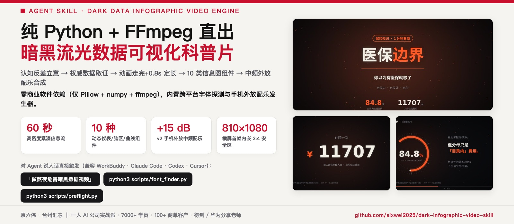
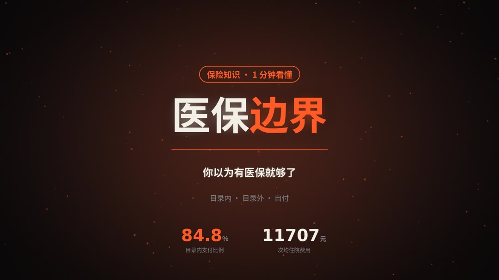
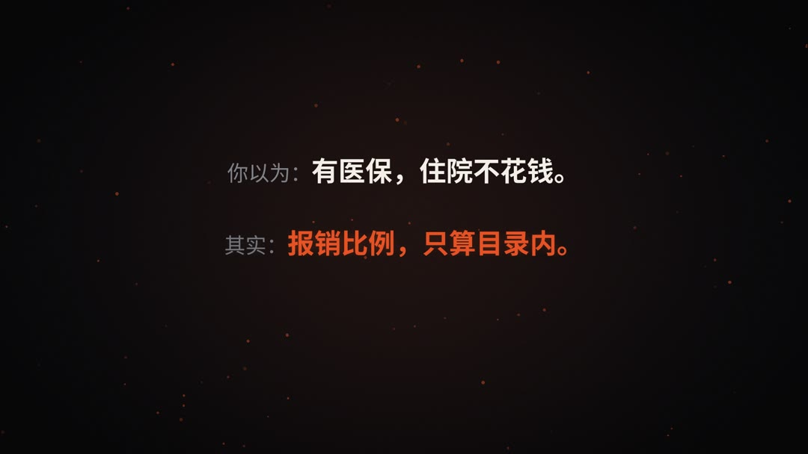
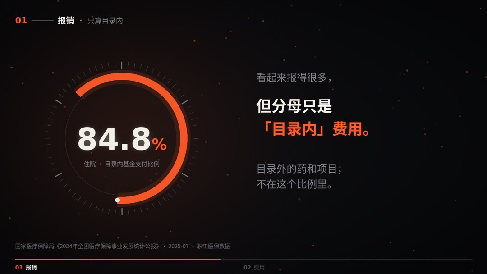
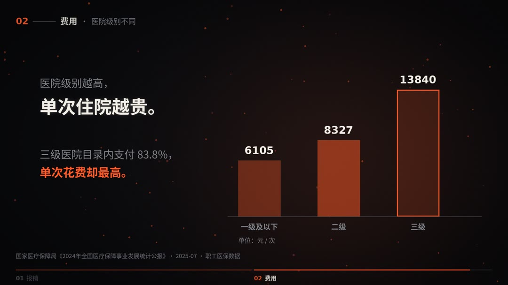
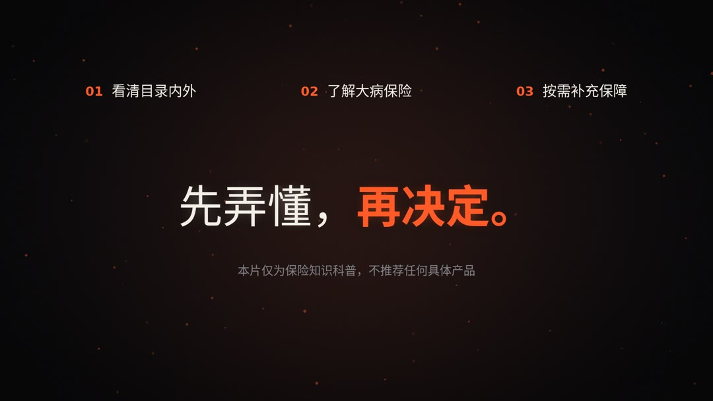
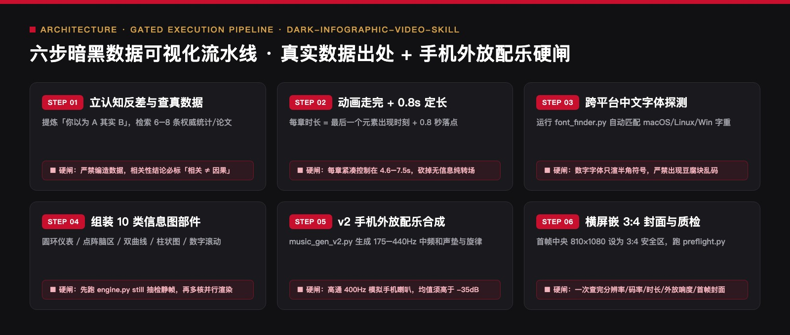

<div align="center">



# 暗黑流光数据科普短视频 Skill
### `dark-infographic-video-skill` · 纯 Python + FFmpeg 驱动的 60fps 霓虹流光信息图短视频引擎

[](https://agentskills.io)
[](#三流水线架构与核心技术规格)
[](#四两大高频翻车点根治方案写进代码的硬约束)
[](LICENSE)

> 🔴 **作者：袁六伟 · 台州汇芯**｜一人 AI 公司创业者，学员 7000+，客户 100+，得到 / 华为分享老师  
> 📮 更多 AI 工具实测与自动化实战，关注 **公众号 / 视频号：袁六伟**

**无需 Node.js、无需浏览器、无需外部素材——纯 Python + FFmpeg 直接渲染 1080×1920 @ 60fps 暗黑流光数据可视化科普片。**  
专为硬核健康科普、AI 原理解析、商业数据拆解打造：自带 **多层 Alpha 高斯辉光（Neon Glow）**、**呼吸态人体/大脑剪影**、**60fps 缓动仪表盘**，以及针对手机扬声器专门调校的 **v2 中高频打击感合成器配乐**。

```bash
# 方式 A：通过 skills CLI 一键安装（推荐）
npx skills add sixwei2025/dark-infographic-video-skill

# 方式 B：克隆到本地并安装轻量 Python 依赖
git clone https://github.com/sixwei2025/dark-infographic-video-skill.git
cd dark-infographic-video-skill && pip install pillow numpy scipy edge-tts
```

[成片动图与分镜画廊](#一60fps-成片动图与-6-幕分镜画廊) · [快速运行](#二30-秒快速运行) · [流水线架构与动效公式](#三流水线架构与核心技术规格) · [两大翻车点根治方案](#四两大高频翻车点根治方案写进代码的硬约束) · [故障排查](#五常见问题与故障排查)

</div>

---

## 一、60fps 成片动图与 6 幕分镜画廊

> 示例成片：**《饭后犯困（食困症）：不是缺觉，是血糖与食欲素的双重狙击》**（`1080×1920` · `60fps` · 42 秒完整成片）

<p align="center">
  
  &nbsp;&nbsp;&nbsp;&nbsp;
  
</p>

| 01 · 3:4 居中封面帧 | 02 · 痛点数字滚动钩子 | 03 · 双通路正反对比图 |
| :---: | :---: | :---: |
|  |  |  |
| **04 · 60fps 血糖飙升仪表盘** | **05 · 暗黑流光动态柱状图** | **06 · 结尾金句收口** |
|  |  |  |

---

## 二、30 秒快速运行

### 1. 在 Agent 中自然语言触发

| 你对 Agent 说的话 | 自动执行的动作 |
| :--- | :--- |
| `用暗黑流光风格做一条「为什么熬夜第二天反而精神，第三天彻底崩溃」的视频` | 自动设计 6 幕数据图表分镜 → 生成 Edge-TTS 配音 → 合成 v2 电子脉冲配乐 → 渲染 60fps 成片 |
| `重新生成配乐，手机外放鼓点再明显一点` | 单独运行 `scripts/music_gen_v2.py` 重新混音，无需重跑 60fps 画面帧 |

### 2. 命令行运行完整示例

```bash
cd examples/food_coma
# 1. 生成中高频增强版电子脉冲配乐（BGM + 6幕转场音效）
python3 ../../scripts/music_gen_v2.py

# 2. 渲染 60fps 暗黑流光画面 + 合成配音 + 写入 810×1080 (3:4) 封面
python3 build_v2.py
```

---

## 三、流水线架构与核心技术规格

<p align="center">
  
</p>

### 1. 暗黑霓虹色板规范（`#07090F` 深空蓝黑基底）

| 语义角色 | 色值 | 适用视觉元素 |
| :--- | :--- | :--- |
| **深空底色** | `#07090F` + `#101726` 网格 | 全片背景 + `60px` 坐标网格 + 顶部径向微光 |
| **科技电光青** | `#00F0FF` `(0, 240, 255)` | 核心机制箭头、神经通路、主进度环 |
| **警戒绯红** | `#FF2A5F` `(255, 42, 95)` | 血糖峰值、警报阈值、错误做法叉号 |
| **能量琥珀金** | `#FFB800` `(255, 184, 0)` | 核心数值高亮、胰岛素/激素标签 |
| **生物荧光绿** | `#00E676` `(0, 230, 118)` | 正确自救方案、恢复稳态曲线 |

### 2. 「动画时长 + 0.8s 凝视留白」铁律

很多信息图视频之所以让人觉得「眼花缭乱看不清」，是因为动画一停马上切下一幕。本引擎强制执行 **动效展开期 + 静态阅读留白期**：

| 幕次 | 叙事功能 | 画面入场缓动时长 | 静态阅读留白 | 最低总时长 |
| :---: | :--- | :---: | :---: | :---: |
| **S1** | 痛点反常识钩子 | `0.8s`（人体剪影呼吸点亮） | `≥ 2.5s` | `≥ 5.0s` |
| **S2** | 核心指标仪表盘 | `1.2s`（`ease_out_cubic` 指针飙升） | `≥ 3.0s` | `≥ 6.5s` |
| **S3** | 双通路机制拆解 | `1.5s`（左右通路依次流光点亮） | `≥ 4.0s` | `≥ 8.0s` |
| **S4** | 对比曲线 / 柱状图 | `1.2s`（双曲线动态绘制） | `≥ 3.5s` | `≥ 7.5s` |
| **S5** | 3 步实操自救清单 | `1.5s`（3 张毛玻璃卡片错峰滑入） | `≥ 4.0s` | `≥ 8.5s` |
| **S6** | 一句话金句收口 | `0.8s`（中心脉冲收敛） | `≥ 2.5s` | `≥ 4.5s` |

---

## 四、两大高频翻车点根治方案（写进代码的硬约束）

### 翻车点 1：配乐在电脑戴耳机好听，手机外放完全听不见？
- **根因**：手机扬声器物理频响在 `< 200Hz` 几乎完全衰减，传统 `55Hz–110Hz` Sub-bass 暗黑氛围音乐在手机外放时等于静音。
- **根治方案（`scripts/music_gen_v2.py`）**：
  1. **全频段上移至 220Hz–3520Hz**：包含 `880–1760Hz` 8-bit 琶音、四次谐波温暖 Pad、带 `2500Hz` 瞬态 Click 的 Kick 鼓点，以及 `2000–6000Hz` 带通 Hi-Hat。
  2. **双轨响度锁死**：人声轨 `loudnorm=I=-14:TP=-1.5`，BGM 轨 `loudnorm=I=-23:TP=-2.0`（混音时 `volume=0.50`），实测中高频能量比 v1 提升 **+15dB**，手机外放清晰有节奏感且绝不盖人声。

### 翻车点 2：9:16 封面发到视频号/小红书主页，上下标题被裁掉一半？
- **根因**：视频号与小红书个人主页信息流默认按 **`3:4`（即 `1080×1440`）** 居中裁切竖屏视频。
- **根治方案**：
  1. 独立生成 **`810×1080`（严格 `3:4`）** 封面图 `cover_3x4.jpg`，所有大字距顶/底留足 `≥ 90px` 安全边距。
  2. 使用双流封装命令把 `3:4` 封面直接写进 MP4 的 `attached_pic` 流：
     ```bash
     ffmpeg -y -i video_raw.mp4 -i cover_3x4.jpg        -map 0:v:0 -map 0:a:0 -map 1:v:0        -c:v:0 copy -c:a:0 copy -c:v:1 mjpeg        -disposition:v:1 attached_pic final_output.mp4
     ```

---

## 五、常见问题与故障排查

| 现象 | 原因定位 | 一键修复方法 |
| :--- | :--- | :--- |
| 中文标题变成方框 `□□□` | 系统未找到苹方/思源黑体路径 | 检查 `FONT_PATHS` 列表，macOS 默认使用 `/System/Library/Fonts/PingFang.ttc` |
| 60fps 渲染速度慢 | 全尺寸高斯模糊次数过多 | 将辉光层先缩小 `1/2` 做 `GaussianBlur`，再放大贴回主画布 |
| 尾音还没说完就切下一幕 | 幕时长写死未对齐 TTS | 用 `ffprobe` 读取每段 `tts_sX.mp3` 真实时长，强制 `scene_dur = max(tts_dur + 0.6, min_dur)` |

---

## 关于作者与开源生态

**袁六伟 · 台州汇芯**：一人 AI 公司创业者，学员 7000+，服务商单客户 100+，覆盖近 20 个行业，得到 / 华为分享老师。AI 变现实战派，自己跑通才拿出来教。

- 公众号：**袁六伟**（微信搜一搜关注，看更多 AI 工具实测与一人公司实战）
- 视频号：**袁六伟**

这个项目免费开源。如果它帮你的产线省下了每天反复返工的时间，欢迎在右上角点个 ⭐ **Star**，也欢迎转发给身边做内容或一人公司的朋友。

### 同系列开源 Skill 矩阵（袁六伟 · 台州汇芯）

| 仓库 | 领域 | 核心能力 |
| :--- | :--- | :--- |
| [**workbuddy-wechat-autopilot**](https://github.com/sixwei2025/workbuddy-wechat-autopilot) | 公众号全链路 | 九步硬闸总控：选题→写稿→真实截图→6套封面→6套排版→三重校验→草稿箱 |
| [**wechat-cover-skill**](https://github.com/sixwei2025/wechat-cover-skill) | 公众号视觉 | 封面渲染引擎（6套高客单价杂志风 + 黑红金 v2b + DOM 几何硬闸） |
| [**gzh-million-layout-skill**](https://github.com/sixwei2025/gzh-million-layout-skill) | 公众号排版 | 汇芯红 `#C8102E` 六套 100% 内联 CSS 骨架 + 乱码硬闸 + 配图皮肤 |
| [**ai-tool-review-wechat-skill**](https://github.com/sixwei2025/ai-tool-review-wechat-skill) | 公众号评测 | AI 工具真跑评测工作流（5项一票否决 + 说人话硬闸 + 证据表） |
| [**hit-title-expert-skill**](https://github.com/sixwei2025/hit-title-expert-skill) | 爆款标题 | 一次直出 10 条 14–22 字高浓缩狠标题（5大公式 × 5类钩子词） |
| [**auto-tutorial-skill**](https://github.com/sixwei2025/auto-tutorial-skill) | 短视频工程 | 链接/网页/真机截图 → 3:4 封面 + 1.5x 配音 + 红框标注教程视频 |
| [**talking-head-video-skill**](https://github.com/sixwei2025/talking-head-video-skill) | 短视频工程 | 1080×1920 竖屏真人口播短视频（ASR 错字校对 + 逐字卡拉OK字幕 + 6项QC） |
| [**3d-map-video-skill**](https://github.com/sixwei2025/3d-map-video-skill) | 短视频工程 | MapLibre 3D 地形 + WarFX 战争特效（粒子行军/点阵兵力/震屏混音） |
| [**psych-kepu-video-skill**](https://github.com/sixwei2025/psych-kepu-video-skill) | 短视频工程 | Remotion + JSON 驱动的 15–30s 深色扁平动画心理科普短视频 |
| [**dark-infographic-video-skill**](https://github.com/sixwei2025/dark-infographic-video-skill) | 短视频工程 | 纯 Python + FFmpeg 暗黑流光数据可视化科普片（含 v2 手机外放配乐） |
| [**local-video-hub**](https://github.com/sixwei2025/local-video-hub) | AI 团队基建 | 视频版本地 Obsidian：多 AI 员工统一交片、去重门闸与四态流转云台 |
| [**yuanliuwei-ai-skills**](https://github.com/sixwei2025/yuanliuwei-ai-skills) | 一人公司方法 | PACT 72h 需求验证模型与一人 AI 公司 10 大业务决策模块 |
| [**book-skill**](https://github.com/sixwei2025/book-skill) | 知识工程 | 上传任意书籍 PDF → 自动提炼方法论生成 `.skill` + 公众号导流文案 |
| [**huangdi-skill**](https://github.com/sixwei2025/huangdi-skill) | 认知操作系统 | 中国历史八大皇帝（秦始皇/汉武帝/唐太宗等）一手史料认知框架蒸馏 |
| [**sunrise-tracker**](https://github.com/sixwei2025/sunrise-tracker) | 选题雷达 | 小红书 AI 赛道 10 倍异常流量「低粉爆文」每日早 7 点监测推送 |
